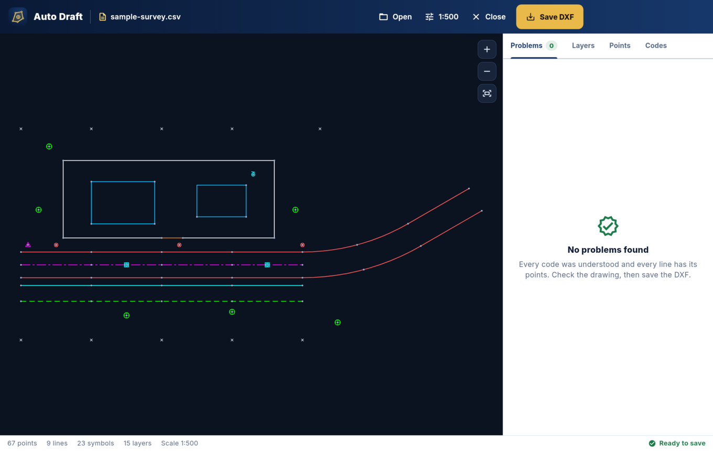

<p align="center"></p>

<h1 align="center">Auto Draft</h1>
<p align="center"><b>Survey points to a finished drawing</b><br>
The day's total station points in, a CAD drawing out: lines joined by their field codes, symbols placed,
levels written, every feature on its own layer.</p>

---

## What it does

1. **Open** the survey (or drag it onto the window): CSV, TXT or Excel (.xlsx) with point number, easting,
   northing, level and code.
   The columns are guessed (header names, or the usual P, E, N, Z, Code order) and can be corrected.
2. **Check** the drawing on screen. Anything doubtful is listed: codes not in the code list, lines with one
   point, a line that jumps far (points out of order), the same point number twice, missing or zero levels.
   Click a problem to see it. An unknown code is added to the list, or changed on every point, in one click.
   Click a point on the drawing to see it and change its code; it redraws at once. Every change can be
   undone (Ctrl+Z) and redone (Ctrl+Y), and the corrected points can be saved as CSV.
3. **Save the DXF**: real (UTM) coordinates in metres, one layer per feature with its colour and line type,
   a symbol block for each point feature, level text sized for the scale (1:500, 1:1000…), optional point
   numbers and codes, flat or 3D lines. DXF R12, so AutoCAD, AutoCAD LT, Civil 3D, BricsCAD, ZWCAD, QGIS and
   Global Mapper all open it.
4. **Print**: the sheet round the survey (paper A4–A0 or the smallest that fits, frame, coordinate grid,
   legend from the codes used, north arrow, scale bar, notes, title block with the firm, title, date and
   drawing number), in the DXF and as a PDF at scale.

<p align="center"></p>

## Field codes

| Typed | Meaning |
|---|---|
| `RE1`, `RE2` | Road edge 1 and road edge 2: the number after a code keeps lines apart |
| `RE1 ST` | Start a new road edge 1 at this point |
| `RE1 END` | The last point of this line |
| `BLD1 CLS` | Close the building back to its first corner |
| `BLD2 RECT` | On the 3rd corner of a rectangle: the 4th corner is added and the shape closed |
| `WL1 ARC` … `WL1 EARC` | A smooth curve through the points from ARC to EARC |
| `WL1 GT1` | One point on two lines (a wall and a gate) |
| `TR`, `MH`, `EPL` | Point codes: a symbol at the point |

The standard list has 38 codes (roads, buildings, walls, fences, drains, banks, poles, trees, manholes,
benchmarks, spot levels…). The full guide: [docs/CODES.md](docs/CODES.md). Codes can be added, changed and
removed in the Codes tab (layer, colour, line type or symbol), and a team's own list saved and loaded as a file.

## Repository

| Folder | What is inside |
|---|---|
| `lib/src/engine/` | the engine, plain Dart with no Flutter: import, codes, line builder, checks, geometry, DXF writer |
| `lib/src/` | the Windows app: window, drawing view, side panel, dialogs, settings, self-update |
| `tool/autodraft.dart` | the engine on the command line: `dart run tool/autodraft.dart survey.csv drawing.dxf` |
| `tool/check_dxf.py` | opens a DXF with ezdxf (reader and auditor) and draws it to a PNG |
| `tool/make_sample.py` | writes the sample survey in `assets/samples/` |
| `installer/` | NSIS installer: per user, no administrator rights |
| `.github/workflows` | `check.yml` on every push, `release.yml` on a `v*` tag |
| `docs/` | the plan, the code guide, release notes |

## Build and test

```
flutter pub get
flutter test                                   # engine and app tests
dart run tool/autodraft.dart assets/samples/sample-survey.csv sample.dxf
dart run tool/autodraft.dart assets/samples/sample-survey.csv sheet.dxf --pdf sheet.pdf --title "Plot 42"
python3 tool/check_dxf.py sample.dxf sample.png   # needs: pip install ezdxf matplotlib
SHOTS_DIR=shots flutter test test/shots_test.dart # pictures of the screens
flutter build windows --release                # on Windows
```

**Releases:** push a tag such as `v0.1.0` (or publish a GitHub release with a new tag). The workflow builds
`AutoDraft-Setup.exe` and `latest.json` (version and SHA-256) and attaches them to the release; installed
copies offer the update and check the SHA-256 before running it.

## Licence

Copyright © 2026 Asjad Mehmood. All rights reserved. See [LICENSE](LICENSE).
Developed by [www.exceltokml.com](https://www.exceltokml.com/).
